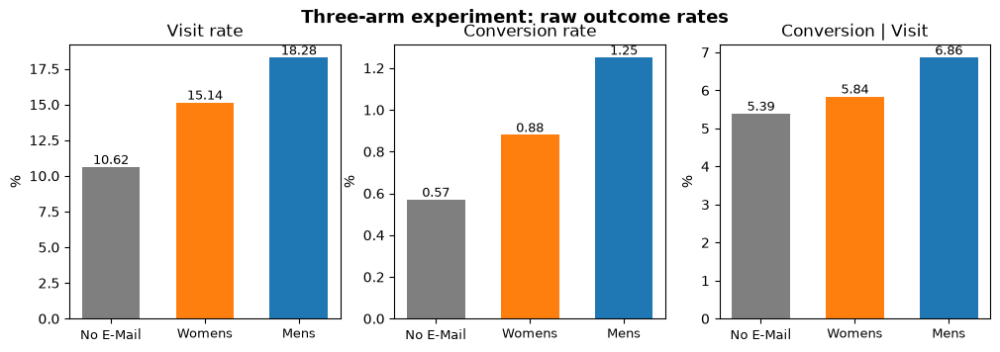
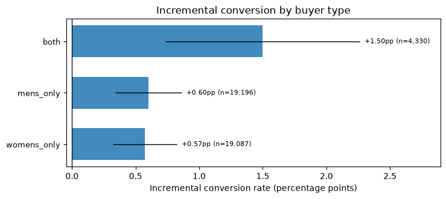
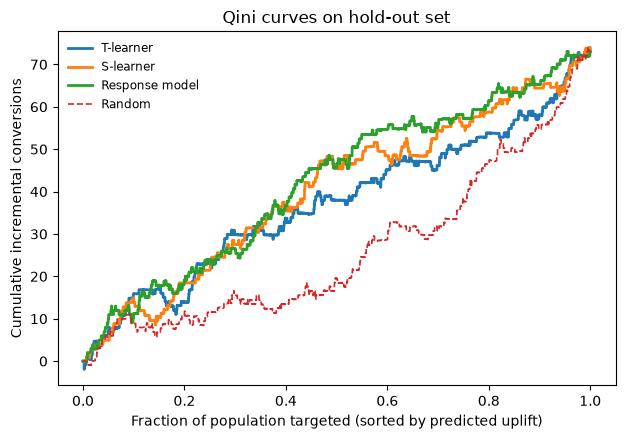
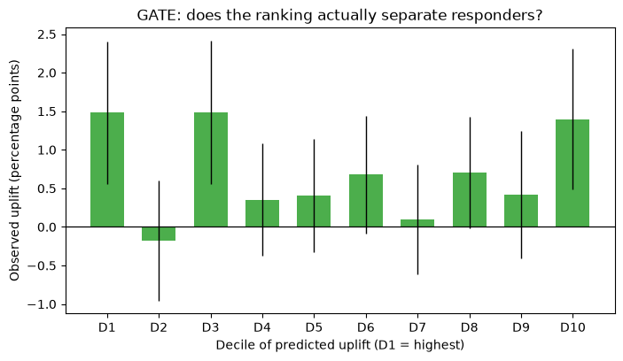
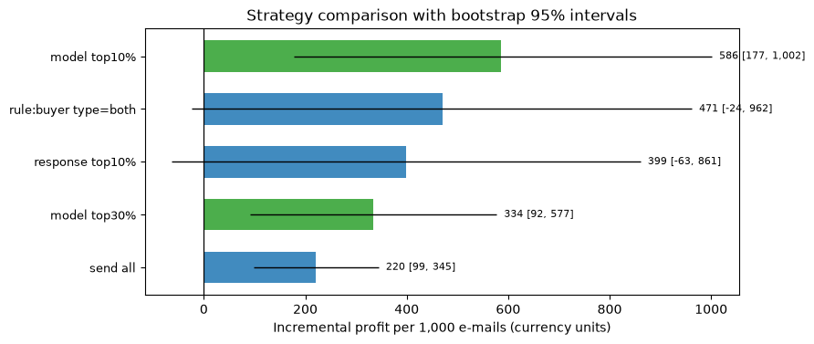
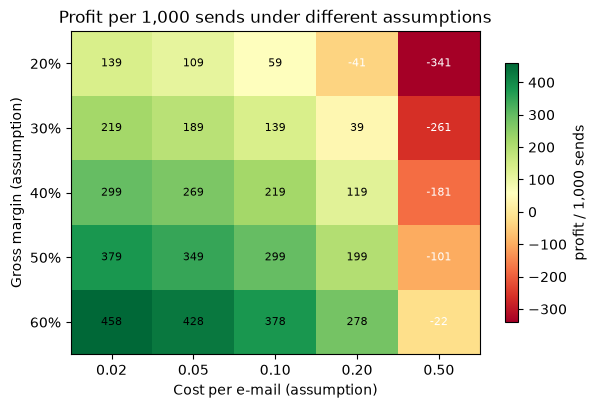

# 邮件营销的增量评估与预算分配

[](https://github.com/yao-chi/email-uplift-lab/actions/workflows/tests.yml)


> 用一场 64,000 人的真实随机对照实验（Hillstrom MineThatData E-Mail Analytics），
> 回答三个业务问题：**发不发**（值不值得发）、**发给谁**（定向有没有用）、**发多少**（预算最优规模）。
> 结论不是"模型很准"，而是"哪条结论有统计证据、哪条没有"。

<p align="center">
  
</p>

## 一句话结论

**Mens E-Mail 这一版创意全胜，平均让访问率提升 7.60 个百分点、转化率提升 0.675 个百分点；
增量在"既买男装又买女装"的客群上翻倍（+13.4pp，交互项 p=1.5e-06）。
但个体级 uplift 建模在本数据量下无法证明优于随机排序（AUUC 仅比随机高 2%~16%，置信区间覆盖随机基线），
所以可落地的结论是"发给谁"这件事的证据只在客群层面，不在个体层面。**

| 结论 | 数字 | 证据强度 |
|---|---|---|
| 实验分组无偏 | SRM p=0.904，最大 \|SMD\|=0.0164 | 强（设计检验） |
| Mens 邮件有效 | 访问 +7.60pp [6.95, 8.25]，转化 +0.675pp [0.49, 0.86] | 强（p<1e-10） |
| 类目客群增量翻倍 | both 客群 +13.44pp vs 其余 +6.99pp，差 +6.46pp（p=1.5e-06） | 强 |
| 创意要匹配客群 | Womens 邮件发给"只买男装"的人仅 +1.11pp（其余 +7.31pp） | 强（p<1e-15） |
| 全量投放赚钱 | 每千封净利 218.9 [99.2, 344.6]（盈亏平衡增量 0.215%，实测 0.685%） | 强 |
| 个体级定向更赚？ | 模型 top10% 点估计 585.8 元/千封，但区间 [177.5, 1001.6] 与全量重叠 | **不成立/不确定** |
| 个体模型超过分群规则？ | 分群参照 AUUC +5.3%，三个模型点估计 +2%~+16%，区间均覆盖随机 | **没有证据** |

## 为什么这个项目值得看

大部分"营销分析"项目止步于"算一下各群转化率然后画个图"，会犯两个典型错误：

1. **把响应率当成增量**。老客转化率高，不代表邮件对他有用——他本来就会买。真正的增量要用随机对照实验估计。
2. **把噪声当成异质性**。把客群切成十几份，总能找到"增量最高"的一格，那是选择效应不是发现。

这个项目把两件事都做成了可检验的形式：ATE 用协变量调整 + Holm 校正，异质性用**交互检验**（差分中的差分），
uplift 模型用 **Qini/AUUC + bootstrap** 评价，最后用**功效分析**说明"这个样本量本来能分辨多大的差异"。

## 分析链路

```
原始 CSV (64,000 × 12)
   │
   ├─ 01 数据体检 ........... 重复行/漏斗一致性/SHA256
   ├─ 02 SQL 口径层 (DuckDB)  三臂指标 + 7 个维度的分群指标（UNPIVOT 长表）
   ├─ 03 实验有效性 ......... SRM 卡方 + 标准化均值差 (SMD)
   ├─ 04 因果估计 ........... 协变量调整 ATE (HC1) + Holm 多重比较 + CUPED
   ├─ 05 异质性 ............. 分群增量 + 2×2 交互检验
   ├─ 06 增量建模 ........... T-learner / S-learner / 响应模型 + Qini/AUUC/GATE
   ├─ 07 决策 ............... 盈亏平衡点 / 策略对比 / bootstrap 区间 / 敏感性网格
   └─ 08 功效分析 ........... MDE：当前样本能分辨多大的增量差异
```

SQL 层放在 `sql/` 下（`01_staging` 建宽表、`02_arm_metrics` 三臂口径、`03_segment_metrics` 用 `UNPIVOT`
一次产出所有维度），Python 层只做统计与建模——**口径和计算分离**，方便别人复核。

## 关键结果

### 1. 实验是干净的，但"干净"不等于"有信息"

三臂人数 21,307 / 21,387 / 21,306，SRM 卡方 p=0.904；处理组与对照组的 11 个协变量最大标准化差 0.0164（远小于 0.1 的常用阈值）。
这是后续所有因果解读的前提。

### 2. 三臂对比：Mens 创意全面胜出

| 臂 | 访问率 | 转化率 | 人均消费 | 访问增量 | 转化增量 |
|---|---|---|---|---|---|
| No E-Mail | 10.62% | 0.573% | 0.653 | — | — |
| Womens E-Mail | 15.14% | 0.884% | 1.077 | **+4.54pp** [3.91, 5.16] | **+0.311pp** [0.149, 0.472] |
| Mens E-Mail | 18.28% | 1.253% | 1.423 | **+7.60pp** [6.95, 8.25] | **+0.675pp** [0.494, 0.855] |

Holm 校正后 6 个检验全部显著。如果当年这场实验只跑了"发女装邮件 vs 不发"（更符合直觉的选择），
会得出"邮件营销效果一般"的结论，而真实可拿到的增量是它的 1.7 倍。

### 3. 增量在客群层面确实不同——但只在客群层面

<p align="center">
  
</p>

按"买过男装/女装"切客群（实验前信息，不是结果变量）：

| 客群 | 占比 | 访问增量 | 转化增量 |
|---|---|---|---|
| 既买男装又买女装 | 10.2% | **+13.44pp** | **+1.50pp** |
| 只买男装 | 45.0% | +6.92pp | +0.60pp |
| 只买女装 | 44.8% | +7.06pp | +0.57pp |

"both" 与其余人的**增量差**（差分中的差分）为 +6.46pp，SE=1.34pp，p=1.5e-06；转化口径 +0.913pp，p=0.023。
注意这里检验的是"增量差"而不是"转化率差"——后者会把基准率差异误当成增量差异。

另一个方向的结果同样重要：**Womens 邮件发给"只买男装"的人，访问增量只有 +1.11pp，而发给其余人 +7.31pp（差 -6.20pp，p<1e-15）**。
创意和客群不匹配时，钱基本白花。

### 4. 个体级 uplift 建模：排序信号存在，但证明不了比随机好

<p align="center">
  
</p>

留出集（21,307 人，按处理 × 转化四格分层切分）上：

| 模型 | AUUC | 相对随机 | top10% 实测增量 | bootstrap 95% 区间 |
|---|---|---|---|---|
| T-learner | 0.001749 | +2.1% | 1.48% | [0.55%, 2.41%] |
| S-learner | 0.001884 | +10.0% | 1.30% | [0.41%, 2.19%] |
| 响应模型（只预测"谁会买"） | 0.001980 | +15.6% | 1.07% | [0.08%, 2.06%] |
| **分群参照**（用训练集 buyer_type 真实组增量排序） | 0.001804 | +5.3% | — | — |
| 随机排序 | 0.001231 | 基线 | 0.83% | [0.08%, 1.58%] |

最后一行是关键参照：**一条只用 `buyer_type` 的人工规则，AUUC 只比随机高 5.3%**。
三个个体模型点估计更高（+2%~+16%），但它们的区间都覆盖随机基线，**也没有稳定超过这条人工规则**。

三个模型的 AUUC 的 95% 区间（如 T-learner [0.00101, 0.00247]）**都覆盖随机基线 0.00171**。
GATE 十分位也不单调：D1 增量 1.48%、D2 是 **-0.18%**、D10 反而有 1.40%。

<p align="center">
  
</p>

**这不是模型没调好，而是信息量不够。** 功效分析（转化率基数 1.25% vs 0.57%）：

- 当前样本每个格子约 1,065 人，**最小可检测差异（MDE, 80% power）是 1.63pp**；
- 想稳定检出 0.2pp 的增量差异，每格需要约 **71,082 人**（四格合计约 28 万人）。

top10% 那个 1.48% 看起来是总体 0.685% 的两倍，但它的区间 [0.55%, 2.41%] 和总体区间是叠着的——
**用一次留出集切分挑"最优 k"，得到的就是这类看起来很美的噪声。**

### 5. 决策：全量投放赚钱，定向的证据不够

<p align="center">
  
</p>

单位经济（客单价 AOV=116.36 来自成交样本实测；单封成本 0.10、毛利率 40% 为**假设值**，见敏感性分析）：

| 策略 | 覆盖名单 | 实测增量 | 每千封净利 | bootstrap 95% 区间 |
|---|---|---|---|---|
| 模型 top10% | 10% | 1.48% | 585.8 | [177.5, 1001.6] |
| 规则：只发 both 客群 | 10.4% | 1.23% | 471.4 | [-23.6, 962.0] |
| 响应模型 top10% | 10% | 1.07% | 399.0 | [-63.0, 860.8] |
| 模型 top30% | 30% | 0.93% | 333.5 | [92.0, 577.4] |
| 全量发送 | 100% | 0.69% | 220.0 | [99.2, 344.6] |

读法：
- **全量发送的区间完全在 0 以上**（[99, 345]），这是唯一一个可以放心下的结论：发就比不发赚。
- 定向策略点估计是 2~2.7 倍，但**所有区间都与全量重叠**，所以"定向更赚"在本数据上不成立。
- 盈亏平衡增量是 0.215%，实测 0.685%——有 3.2 倍安全垫，即使成本涨 3 倍仍然为正。

<p align="center">
  
</p>

敏感性网格（成本 0.02~0.50 × 毛利率 20%~60%）：单封成本 ≤0.10 时 5 档毛利率全为正（59.5 ~ 458.4 元/千封）；
成本涨到 0.20 且毛利率 20% 时转负（-40.6）；成本 0.50 时只有毛利率 60% 仍为正（-21.7 ~ -340.6 其余为负）。
**结论的边界是"单封成本不超过 0.1 元"**——这是一句可以用来说服业务方的量化条件。

### 6. CUPED 在这个数据上几乎没用（也照实写）

用实验前的 `history`（过去 12 个月消费额）做 CUPED 协变量，访问率方差只降低 **0.44%**，区间宽度缩小 0.22%。
原因是 `history` 与该用户的访问/转化相关性很弱（θ≈9.1e-05）。
**没有强预实验协变量时，CUPED 不是万能药**——这句话比硬凑一个"方差降低 30%"的假结果有用。

## 我没做的事（以及为什么）

- **没去重那 6,562 行完全重复的记录**：数据没有用户 ID，重复行可能是不同的真实用户，去重会人为缩小样本、改变基准率。
- **没把"响应模型"包装成 uplift 模型**：它预测的是"谁会买"，不是"谁因为邮件才买"，本数据里它和随机排序的差距不显著。
- **没报告"最优 k=10% 提升 168%"这种数字**：那是选择效应，区间一放出来就消失了。
- **没做深度调参**：调参只会让 top-k 的点估计更乐观，不会让区间变窄；在 380 个转化的样本上，这是自欺。

## 复现

```bash
pip install -r requirements.txt
python scripts/run_all.py
# 约 1 分钟；产出 outputs/tables/*.csv、outputs/figures/*.png、reports/results.json
```

环境：Python 3.12，pandas / numpy / scikit-learn / scipy / duckdb / matplotlib，全部 pip 可装，无 GPU、无外部服务。
所有随机性固定（`RANDOM_STATE=20261106`），重跑结果一致。

## 目录

```
├─ data/         原始 CSV（含来源与许可说明）
├─ sql/          01 建宽表 / 02 三臂口径 / 03 分群口径（UNPIVOT）
├─ src/uplift_lab/
│   ├─ data.py        加载、体检、派生特征、分层切分
│   ├─ sql.py         DuckDB 执行层
│   ├─ experiment.py  SRM、SMD、ATE、CUPED、Holm、交互检验、MDE
│   ├─ metrics.py     Qini、AUUC、GATE、top-k、bootstrap
│   ├─ uplift.py      T-learner / S-learner / 响应模型
│   ├─ policy.py      盈亏平衡、策略对比、敏感性
│   └─ plots.py       8 张图
├─ scripts/run_all.py 一键流水线
├─ tests/            指标与统计函数的单元测试
├─ reports/          results.json + 完整分析报告
└─ docs/             教学手册、面试问答、简历写法
```

## 数据来源

Kevin Hillstrom, *MineThatData E-Mail Analytics And Data Mining Challenge* (2008)。
64,000 名顾客，随机分为三组（Mens E-Mail / Womens E-Mail / No E-Mail），
记录实验后两周内的访问、转化与消费额。字段与口径见 `data/README.md`。

## 已知局限

1. **只有 12 个字段**，没有价格、品类明细、曝光时段，无法做更细的异质性。
2. **单次实验、单一品牌**，外部效度有限：结论适合"零售邮件营销"，不能直接迁移到别的渠道。
3. **成本与毛利率是假设值**（0.10 / 40%），真实值需要财务口径；敏感性网格给出了假设失效的边界。
4. **转化事件稀疏**（380 个），这是个体级 uplift 结论不显著的根本原因，不是方法问题。